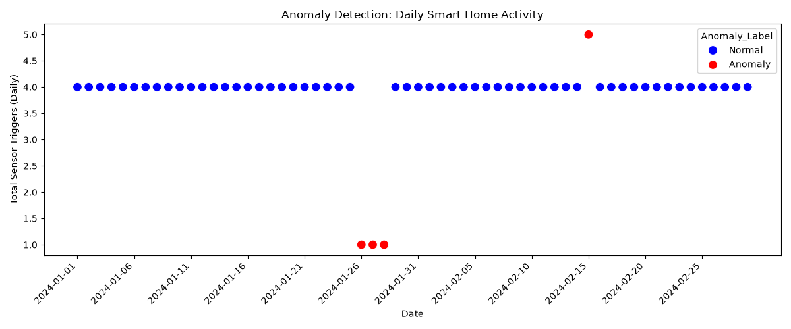

# Smart Home Anomaly Detection for Elderly Care

## 📌 Project Overview
As the population ages, enabling elderly individuals to live independently for longer is critical. This project simulates an IoT (Internet of Things) smart home environment and utilizes unsupervised machine learning to detect behavioral anomalies that could indicate an emergency (e.g., a fall or night wandering).

## 📊 The Data
Because real smart home data is highly sensitive, this project includes a **synthetic data generator** (`01_generate_data.py`) that simulates 60 days of daily sensor activity (Bedroom, Bathroom, Kitchen) for a resident. 
* It simulates a normal routine (waking up ~7 AM, sleeping ~10 PM).
* It injects two specific anomalies: a 3-day "fall" (no movement outside the bedroom) and a single night of "wandering" (kitchen activity at 2 AM).

## 🔬 Methodology
1. **Exploratory Data Analysis:** Visualized hourly activity to establish a baseline of "normal" behavior.
2. **Feature Engineering:** Aggregated raw timestamp logs into daily behavioral summaries. I engineered a specific feature (`Morning_Bathroom_Visits`) to give the model time-of-day context, which allowed it to identify the 3-day fall cluster.
3. **Machine Learning:** Trained an **Isolation Forest** (unsupervised anomaly detection) to isolate days that deviated from the norm. Tuned the `contamination` parameter to balance sensitivity and false alarms.

## 📈 Results
The final Isolation Forest model successfully detected both injected anomalies:
1. **The Night Wandering:** Flagged the unique spike in late-night kitchen activity.
2. **The Fall:** Flagged the 3-day period where overall daily activity dropped to a single bedroom trigger, indicating a potential medical emergency.

## 💡 Business Impact
In a real-world healthcare setting, this pipeline could be integrated into a smart home hub to trigger automated alerts for family members or caregivers if a resident's daily routine deviates drastically from their baseline, enabling faster emergency response times.

## 🛠️ Tech Stack
Python (pandas, numpy, scikit-learn, matplotlib, seaborn)